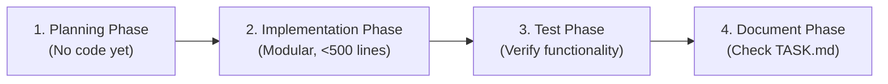

# Vibe Coding Workflow for Antigravity

This skill defines the structured pair-programming lifecycle for this project. Never jump straight into code without following this sequence.

---

## Phase 1: Planning Phase
> **Prompt trigger:** *"Let's plan the <feature name>, don't do code yet."*

1. **Understand Intent & Context**:
   - Inspect references (PRD.txt, Figma links, issue descriptions, docs).
   - Check current architecture in `PLANNING.md` and active tasks in `TASK.md`.
2. **Draft Architectural Plan**:
   - Propose data models, API endpoints, module placements, and component hierarchy.
   - Include a Mermaid diagram explaining interactions or data flow.
3. **Review & Iterate**:
   - Solicit feedback or review with the user. Refine if adjustments are requested.
4. **Persist Plan & Tasks**:
   - Append or update the finalized plan into `PLANNING.md`.
   - List actionable, atomic tasks with estimates in `TASK.md`.
5. **Suggest Commit (No Auto-Commit)**:
   - Provide suggested command for user: `git commit -m "docs: plan <feature name> in PLANNING.md and TASK.md"`

---

## Phase 2: Implementation Phase
> **Prompt trigger:** *"Let's implement <task ID or feature>"*

1. **Check Pre-conditions**:
   - Review `.agent/rules/awareness.md` and `.agent/rules/things-to-avoid.md`.
   - Ensure target files stay under **500 lines of code**.
2. **Modular Development**:
   - Backend logic belongs in `apps/api/app/modules/<domain>/`.
   - Frontend UI belongs in `apps/web/src/features/<domain>/`.
   - Use strict type annotations (Python Pydantic v2 / TypeScript strict).
3. **Capture & Learn from Mistakes**:
   - If a bug, hallucination, or design mistake occurs during development, fix it immediately and **record the rule in `.agent/rules/things-to-avoid.md`**.
4. **Suggest Commit (No Auto-Commit)**:
   - Provide suggested command for user: `git commit -m "feat: implement <feature name>"` or `git commit -m "fix: <issue description>"`

---

## Phase 3: Test Phase
> **Prompt trigger:** *"Let's test the implementation"*

1. **Automated Verification**:
   - Run backend tests: `pytest apps/api/tests/`
   - Run frontend checks: `npm run lint` / `npm test`
2. **Functional Validation**:
   - Test happy path and error boundaries.
   - Verify that actions and tool executions persist to the database.
3. **Suggest Commit (No Auto-Commit)**:
   - Provide suggested command for user: `git commit -m "test: verify <feature name> test cases"`

---

## Phase 4: Document Phase
> **Prompt trigger:** *"Mark task as done and document"*

1. **Update Task Tracker**:
   - Mark the completed item as `[x]` in `TASK.md` with today's completion date.
   - If new tasks were uncovered, add them under `### Discovered During Work`.
2. **Update Documentation**:
   - Add docstrings to public interfaces and update OpenAPI route tags.
   - Update `README.md` or user documentation if public behavior changed.
3. **Suggest Commit (No Auto-Commit)**:
   - Provide suggested command for user: `git commit -m "docs: update TASK.md and documentation for <feature name>"`
