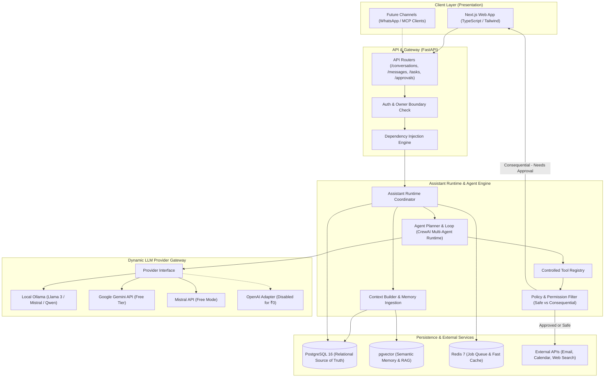
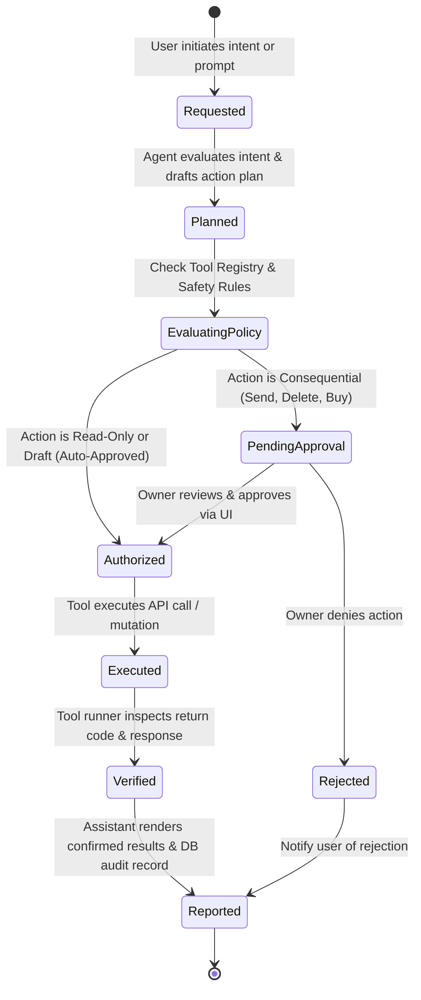
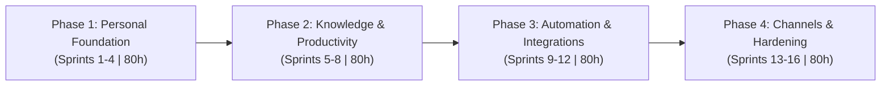
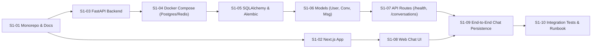

# Comprehensive System Architecture & Planning

> **Project:** Personal AI Assistant  
> **Status:** Stage A (Personal MVP) — Sprint 1  
> **Repository Model:** Monorepo (Next.js Web + FastAPI Backend + PostgreSQL/Redis Infra)  
> **Operating Budget:** ₹0 Target (Local Ollama default, Google Gemini & Mistral free-tier APIs)  
> **Weekly Cadence:** ~10 hours/week (2 hours/day, 5 days/week)

---

## 1. Executive Summary & Product Vision (Product Manager Lens)

The Personal AI Assistant bridges the gap between passive conversational chatbots and proactive autonomous agents. Most commercial AI tools either charge steep monthly subscriptions or act merely as conversational surfaces without verified execution. This project is built for one owner first, proving genuine everyday utility—reading personal context, summarizing incoming documents, planning multi-step actions, and drafting emails/calendar updates—before expanding to multi-user enterprise readiness.

### 1.1 Core Principles
1. **One Assistant, One Truth, Many Channels**: A single centralized backend assistant runtime serves the Next.js web application today, and future WhatsApp, mobile, or MCP client interfaces tomorrow without duplication.
2. **The "Do the Work" Contract**: The assistant never assumes an action was executed. Every workflow advances through verified states:
   $$\text{Requested} \longrightarrow \text{Planned} \longrightarrow \text{Authorized} \longrightarrow \text{Executed} \longrightarrow \text{Verified} \longrightarrow \text{Reported}$$
3. **Free-First (₹0 Infrastructure)**: Runs entirely on local compute (Ollama local inference, Dockerized PostgreSQL + pgvector and Redis) with optional zero-cost cloud tiers (Gemini free tier, Mistral free tier).
4. **Privacy & Permission Gates**: Consequential actions (sending messages, deleting files, external mutations) require explicit human sign-off via an interactive approvals drawer.

---

## 2. High-Level Architecture (Software Architect Lens)

The system is organized as a **modular monolith** with clean boundaries between presentation, coordination, intelligence, and storage.

---

## 3. The "Do the Work" State Machine

Every action initiated by the user or proposed by the agent follows an immutable lifecycle state machine to guarantee that external actions are never hallucinated.

---

## 4. Phase-by-Phase Master Development Plan

The system develops across **4 distinct phases** comprising **16 two-week sprints** (~20 hours per sprint, ~320 hours total).

---

### Phase 1: Personal Foundation (Sprints 1–4 | ~80 Hours)
**Objective:** Establish the local monorepo, web chat UI, database persistence, provider-agnostic model routing, basic tool execution, and personal memory.

- **Sprint 1 — Repository & Basic Web Chat (20h)**:
  - *Deliverables:* Monorepo skeleton (`apps/web`, `apps/api`, `infra/`), Docker Compose (`postgres`, `redis`), SQLAlchemy + Alembic, `User`/`Conversation`/`Message` models, FastAPI CRUD endpoints, Next.js chat UI with message persistence.
  - *Acceptance:* Messages persist to PostgreSQL; reloading browser retains history; owner-scoping verified.
- **Sprint 2 — LLM Gateway & Provider Adapters (20h)**:
  - *Deliverables:* Abstract `LLMProvider` interface; adapters for local Ollama, Google Gemini (Free tier), Mistral (Free mode); disabled OpenAI adapter; token usage/latency logging; dynamic model switcher in web UI.
  - *Acceptance:* Same chat endpoint works with Ollama, Gemini, and Mistral; zero cloud egress when `DISABLE_CLOUD_MODELS=true`.
- **Sprint 3 — Agent Runtime & Controlled Tools (20h)**:
  - *Deliverables:* CrewAI multi-agent orchestration integration behind internal runtime interface; tool registry with Pydantic input schemas; safe initial tools (date/time, calculator, task draft, note search); tool execution activity feed in web UI.
  - *Acceptance:* Agent invokes tools and uses results; unhandled or arbitrary shell/SQL/filesystem access is strictly blocked; tool runs recorded in DB.
- **Sprint 4 — Custom Memory Engine (20h)**:
  - *Deliverables:* Memory extraction pipeline from conversation turns; deduplication & validation; pgvector embedding storage; hybrid semantic + keyword recall; memory viewer/editor/deletion UI.
  - *Acceptance:* Personal facts stored in one conversation are recalled in a separate session; owner-only memory access; user can inspect and delete memories.

*Phase 1 Exit Milestone:* A working local assistant capable of persistent conversation, dynamic model switching, tool execution, and long-term memory recall at ₹0 infrastructure cost.

---

### Phase 2: Knowledge & Daily Productivity (Sprints 5–8 | ~80 Hours)
**Objective:** Equip the assistant with personal document retrieval (RAG), task tracking, email/calendar workflows, and grounded web research.

- **Sprint 5 — Document Knowledge & RAG (20h)**:
  - *Deliverables:* File upload API (PDF, Markdown, TXT); chunking and embedding pipeline with pgvector; hybrid vector + text retrieval; citation and source document display in UI.
  - *Acceptance:* Answers ground strictly in uploaded documents with exact source citations; prompt injection defenses in place.
- **Sprint 6 — Tasks, Notes & Reminders (20h)**:
  - *Deliverables:* Task and Note domain models; CRUD endpoints; conversational task extraction ("remind me to submit invoice by Friday"); priority and due dates; web task dashboard.
  - *Acceptance:* Assistant creates and updates tasks from natural dialogue with explicit confirmation and audit history.
- **Sprint 7 — Email & Calendar Read/Draft Workflows (20h)**:
  - *Deliverables:* OAuth connection for Google/Microsoft personal APIs; thread search and summarization; calendar event reading; draft creation for replies/invites without sending.
  - *Acceptance:* Assistant drafts emails and calendar invites; all external mutations strictly held in pending state awaiting approval.
- **Sprint 8 — Research & Reporting (20h)**:
  - *Deliverables:* Pluggable web search adapter (SearXNG/free APIs); source scraping, citation extraction, comparison matrices, and Markdown report exporter.
  - *Acceptance:* Produces structured research reports with verifiable citations and highlighted uncertainty.

*Phase 2 Exit Milestone:* Assistant actively handles everyday personal productivity—documents, tasks, email/calendar drafts, and research.

---

### Phase 3: Reliable Automation & Integrations (Sprints 9–12 | ~80 Hours)
**Objective:** Enable durable multi-step workflows, human-in-the-loop authorization gates, Model Context Protocol (MCP) tool expansion, and proactive background scheduling.

- **Sprint 9 — Durable Workflow Execution (20h)**:
  - *Deliverables:* Plan representation as execution graphs; step checkpoints; Redis background worker; idempotency keys; retry and pause/resume logic.
  - *Acceptance:* Interrupted workflows resume from last verified checkpoint without repeating completed external actions.
- **Sprint 10 — Approvals, Permissions & Audit Trail (20h)**:
  - *Deliverables:* Policy engine classifying tools (Read/Draft = auto; Consequential = approval required); approval cards in UI; one-time approval tokens bound to exact args; immutable audit log.
  - *Acceptance:* Consequential actions (send email, delete record, execute mutation) cannot execute without interactive owner sign-off.
- **Sprint 11 — MCP Client & Connector Framework (20h)**:
  - *Deliverables:* Model Context Protocol (MCP) client; dynamic tool discovery and schema validation; connector credential scoping and health monitoring.
  - *Acceptance:* External MCP tool servers connect securely under explicit permission contracts.
- **Sprint 12 — Scheduling & Proactive Assistant (20h)**:
  - *Deliverables:* Cron-based recurring job runner; automated daily morning briefings (agenda, tasks, urgent emails); web notification drawer.
  - *Acceptance:* Scheduled jobs run autonomously in background; user can pause, adjust, or disable schedules.

*Phase 3 Exit Milestone:* Assistant autonomously runs multi-step background automations with bulletproof human authorization and MCP extensibility.

---

### Phase 4: Channels & Product Hardening (Sprints 13–16 | ~80 Hours)
**Objective:** Extend access to mobile/messaging channels, harden security and reliability, validate daily usage scenarios, and prepare tenant isolation for enterprise growth.

- **Sprint 13 — WhatsApp Channel Feasibility & Integration (20h)**:
  - *Deliverables:* Inbound webhook receiver; HMAC signature validation; sender phone mapping to owner; message routing to core runtime; outbound notification adapter.
  - *Acceptance:* Owner can message the assistant via WhatsApp; messages execute through the same runtime without duplicated logic.
- **Sprint 14 — Security, Privacy & Reliability (20h)**:
  - *Deliverables:* Token protection, strict rate limiting, input sanitization, automated database backup/restore scripts, Docker vulnerability scanning, failure injection tests.
  - *Acceptance:* Zero unauthenticated endpoints; data export and purge verified; all unit/integration suites pass cleanly.
- **Sprint 15 — Personal Daily-Use Validation (20h)**:
  - *Deliverables:* Execution of 25+ real-world owner workflows; latency and token consumption benchmarks; prompt and retrieval tuning; end-user documentation.
  - *Acceptance:* >95% success rate on owner daily workflows with transparent failure reporting.
- **Sprint 16 — Customer-Readiness Architecture (20h)**:
  - *Deliverables:* Schema migration adding `organization_id` and tenant scoping; RBAC role matrix; tenant-isolated vector search; admin policy console design.
  - *Acceptance:* Multi-tenant data isolation verified by automated cross-tenant security tests.

*Phase 4 Exit Milestone:* A battle-tested, secure personal digital assistant ready for seamless transition into a commercial multi-user product.

---

## 5. Sprint 1 Detailed Execution Blueprint

### Sprint 1 Definition of Done
- [ ] Monorepo structure (`apps/web`, `apps/api`, `infra/`, `packages/`, `docs/`) initialized.
- [ ] Next.js 14+ App Router runs locally on port 3000.
- [ ] FastAPI runs locally on port 8000 with interactive Swagger docs (`/docs`).
- [ ] PostgreSQL 16 + pgvector and Redis run via `compose.yaml`.
- [ ] Alembic migrations run cleanly to create `users`, `conversations`, and `messages` tables.
- [ ] User can create conversations and send messages via the web UI.
- [ ] Message history loads and persists across page reloads.
- [ ] Automated tests in `apps/api/tests` pass.
- [ ] `.env` is safely ignored in `.gitignore`, and `.env.example` is documented.
