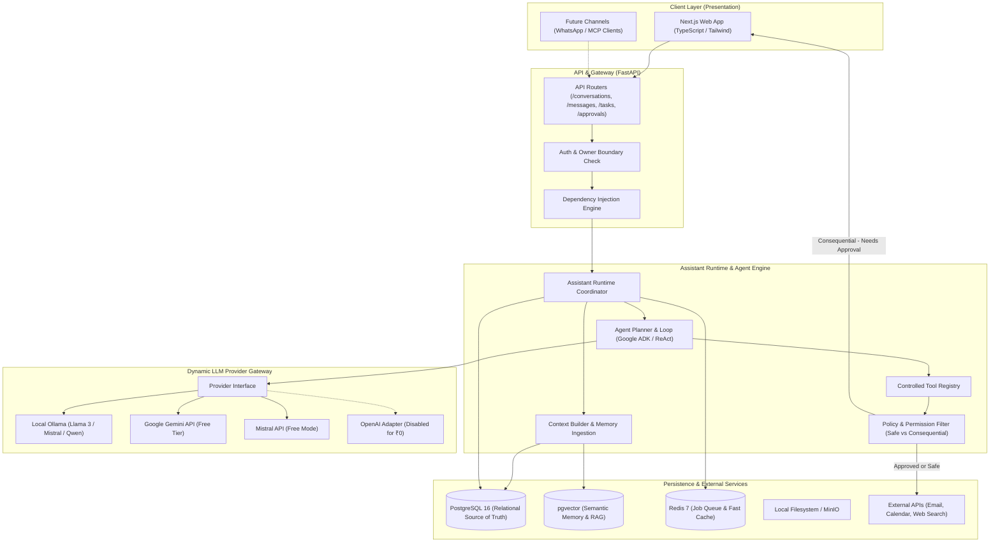
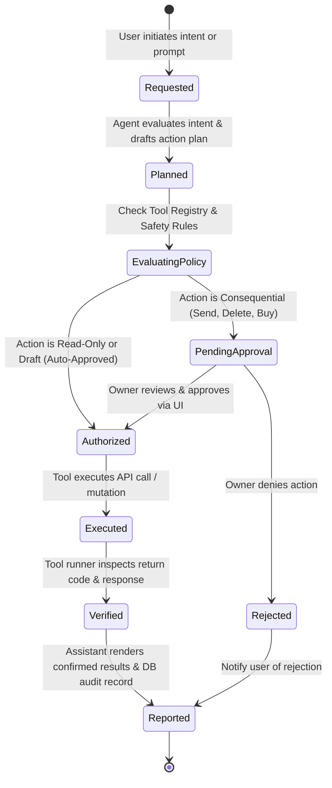
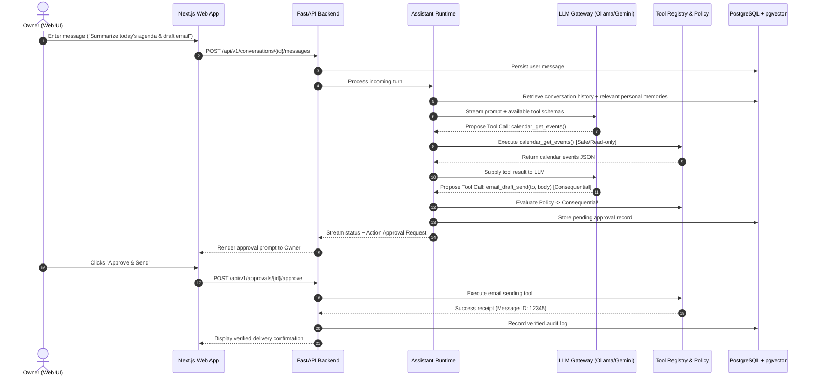
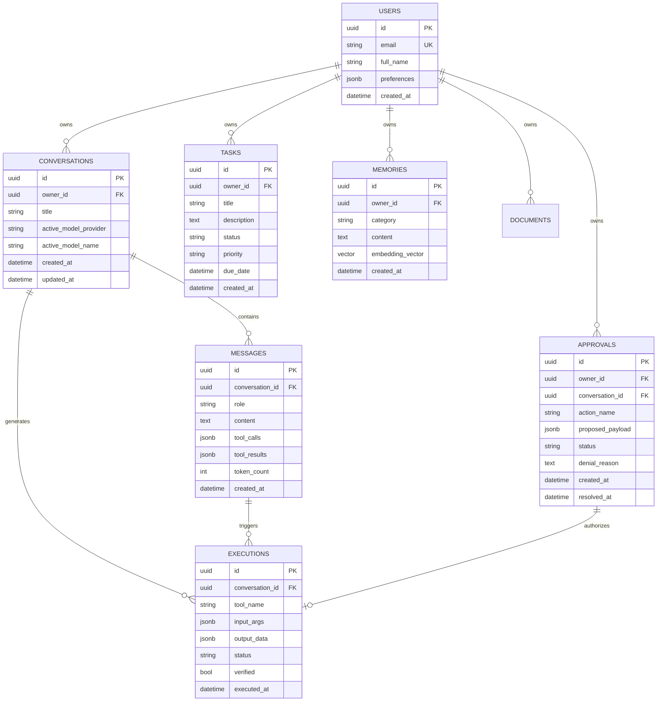
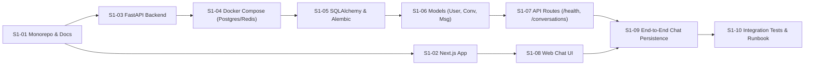

# Comprehensive System Architecture & Planning

> **Project:** Personal AI Assistant  
> **Status:** Stage A (Personal MVP) — Sprint 1  
> **Repository Model:** Monorepo (Next.js Web + FastAPI Backend + PostgreSQL/Redis Infra)  
> **Operating Budget:** ₹0 (Local Ollama default, Google Gemini & Mistral free-tier APIs)  

---

## 1. Executive Summary & Product Vision (Product Manager Lens)

The Personal AI Assistant is built to bridge the gap between passive conversational chatbots and proactive autonomous agents. Most commercial AI tools either charge steep monthly subscriptions or act merely as conversational surfaces without verified execution. This project is built for one owner first, proving genuine everyday utility—reading personal context, summarizing incoming documents, planning multi-step actions, and drafting emails/calendar updates—before expanding to multi-user enterprise readiness.

### 1.1 Core Principles
1. **One Assistant, One Truth, Many Channels**: A single centralized backend assistant runtime serves the Next.js web application today, and future WhatsApp, mobile, or MCP client interfaces tomorrow without duplication.
2. **The "Do the Work" Contract**: The assistant never assumes an action was executed. Every workflow advances through verified states:
   $$\text{Requested} \longrightarrow \text{Planned} \longrightarrow \text{Authorized} \longrightarrow \text{Executed} \longrightarrow \text{Verified} \longrightarrow \text{Reported}$$
3. **Free-First (₹0 Infrastructure)**: Runs entirely on local compute (Ollama local inference, Dockerized PostgreSQL + pgvector and Redis) with optional zero-cost cloud tiers (Gemini free tier, Mistral free tier).
4. **Privacy & Permission Gates**: Consequential actions (sending messages, deleting files, external mutations) require explicit human sign-off via an interactive approvals drawer.

---

## 2. High-Level Architecture (Software Architect Lens)

The system is organized as a **modular monolith** with clean boundaries between presentation, coordination, intelligence, and storage.

### 2.1 Component Architecture Diagram

---

## 3. The "Do the Work" State Machine

Every action initiated by the user or proposed by the agent follows an immutable lifecycle state machine to guarantee that external actions are never hallucinated.

---

## 4. End-to-End Chat & Tool Execution Sequence

---

## 5. Relational Domain Model (Entity-Relationship Blueprint)

---

## 6. Implementation Strategy & Technical Roadmap (Software Developer Lens)

### 6.1 Phased Delivery Overview
- **Sprint 1 (Current)**: Foundation — Monorepo setup, Next.js web chat interface, FastAPI backend, Docker Compose (Postgres + Redis), Alembic migrations, conversation/message persistence.
- **Sprint 2**: LLM Gateway — Unified interface for Ollama, Gemini API (Free tier), Mistral API (Free tier), model switching in UI.
- **Sprint 3**: Agent Runtime & Tool Registry — Google ADK / ReAct loop, tool registry with Pydantic schemas, permission classification.
- **Sprint 4**: Personal Memory Engine — Structured key-value preferences + pgvector similarity matching, context window optimizer.
- **Sprint 5**: Document Knowledge & RAG — Document upload, parsing, vector embedding storage, grounded search.
- **Sprint 6**: Task & Reminders — Task management API, scheduled worker with Redis.
- **Sprint 7**: Email & Calendar Integration — Local/free connectors for read, draft, and approval-gated actions.
- **Sprint 8–16**: Advanced durable workflows, WhatsApp channel, security audits, and multi-tenant preparation.

---

## 7. Sprint 1 Execution Blueprint

### Sprint 1 Definition of Done Checklist
- [ ] Monorepo structure (`apps/web`, `apps/api`, `infra/`, `packages/`, `docs/`) initialized.
- [ ] Next.js 14+ App Router runs locally on port 3000.
- [ ] FastAPI runs locally on port 8000 with interactive docs (`/docs`).
- [ ] PostgreSQL 16 + pgvector and Redis run via `compose.yaml`.
- [ ] Alembic migrations run cleanly to create `users`, `conversations`, and `messages` tables.
- [ ] User can create a conversation and send a message via the UI.
- [ ] Message history loads and persists across page reloads.
- [ ] Automated tests in `apps/api/tests` pass.
- [ ] `.env` is safely ignored in `.gitignore`, and `.env.example` is documented.
